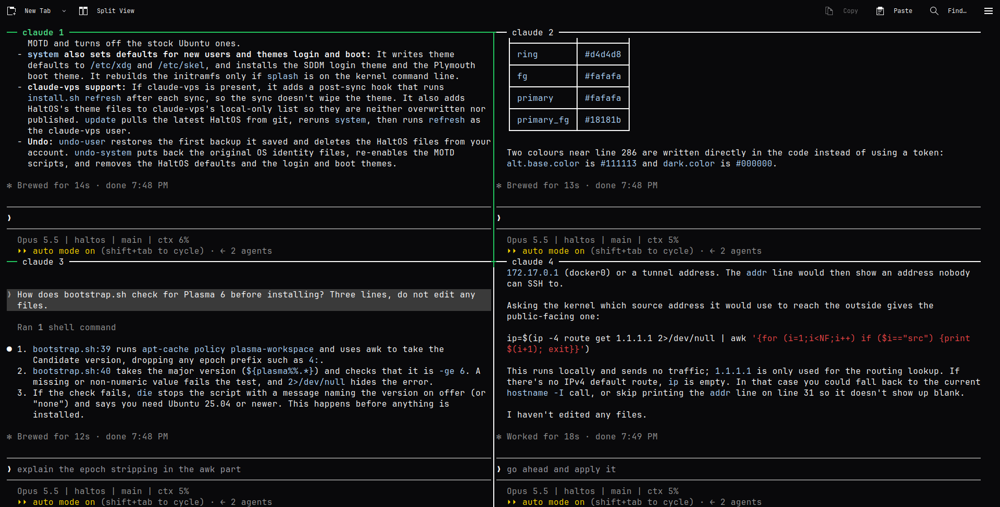
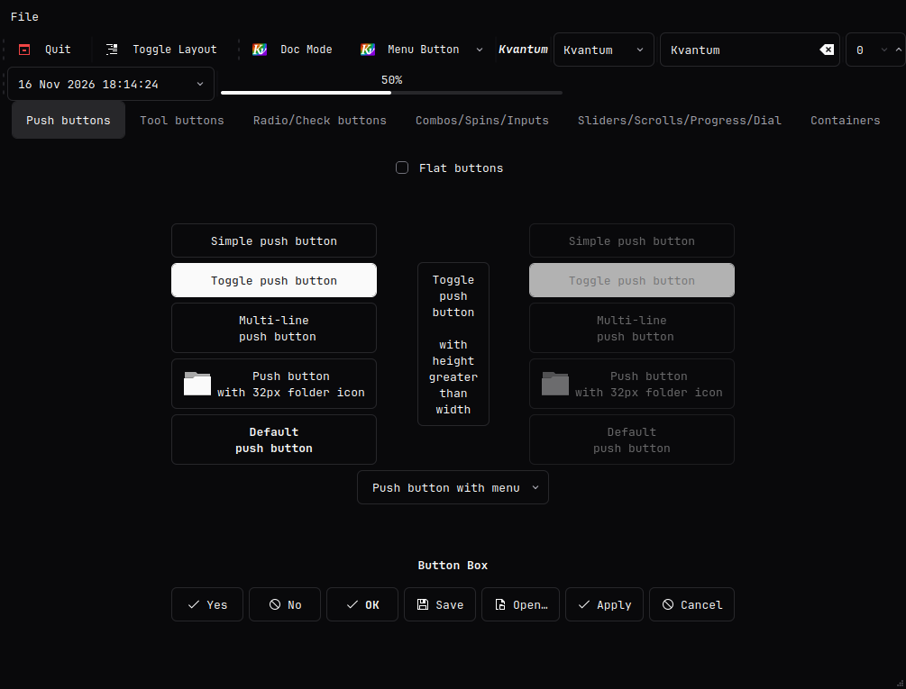
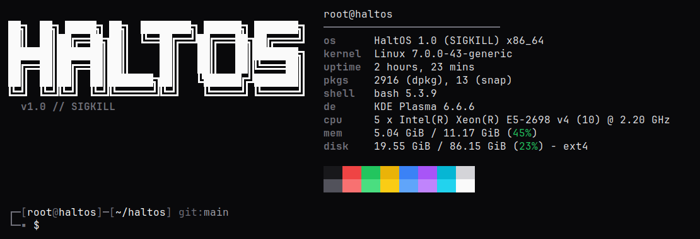
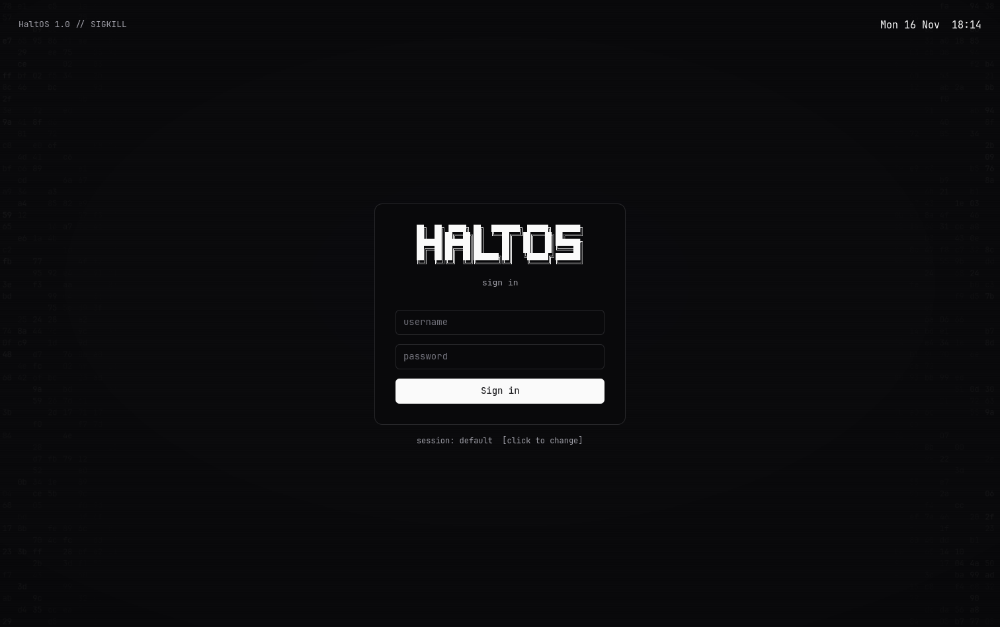
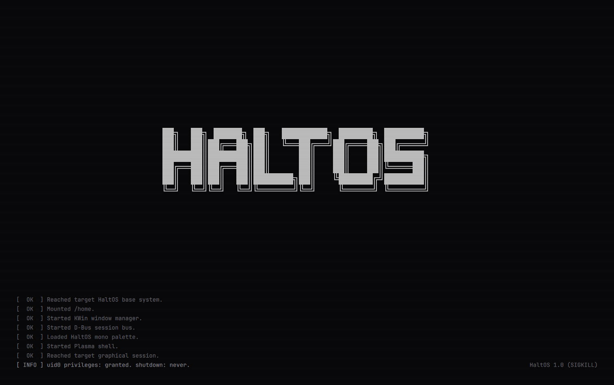
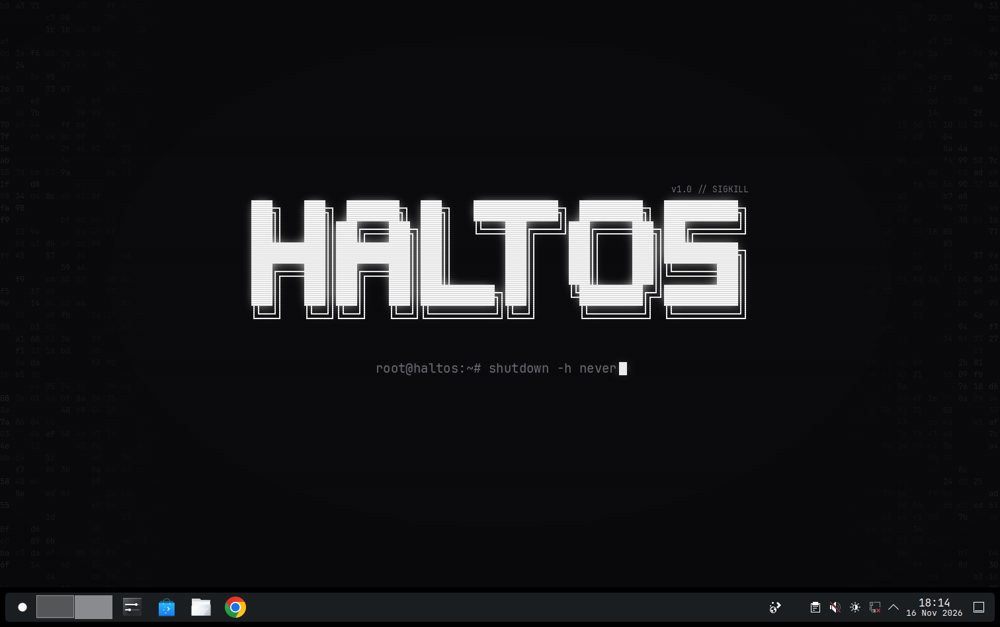
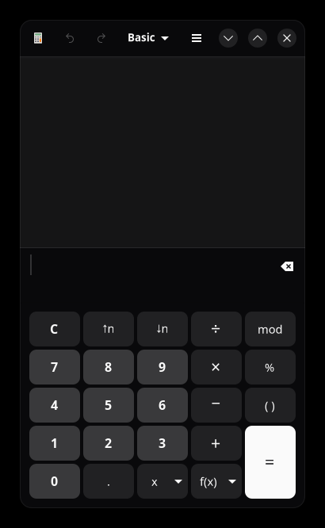

<p align="center" class="logo-section">

<br/>


<p align="center">
A Claude Code workstation OS for your VPS: a monochrome, terminal-flavoured layer that turns an Ubuntu server into a remote KDE Plasma desktop for Claude Code.<br>
<br/>
<br/>

</p>
<p align="center">
<a align="center" href="#installation">Documentation</a>
  </p>
</p>

<p align="center">

</p>

<p align="center">

</p>

- **OS identity**: `/etc/os-release`, `lsb_release`, `/etc/issue` and the KDE About page report `HaltOS 1.0 (SIGKILL)`. `ID=ubuntu` is kept, so apt, PPAs and vendor scripts keep working. Ubuntu's files are preserved with `dpkg-divert`.
- **Claude Code**: [claudegrid](https://github.com/halitsever/claudegrid) opens a grid of Claude Code agents in one window, with a prompt, model and git worktree per pane.
- **Plasma**: `HaltMono` colour scheme (shadcn zinc palette), JetBrains Mono everywhere, ASCII splash with a fake boot log, floating panel with a dot start icon, flat Breeze titlebars.
- **Widgets**: `HaltMono` Kvantum theme with shadcn-style outline buttons, inputs, menus, tabs, checkboxes and thin auto-hiding scrollbars.
- **GTK**: Breeze GTK follows the colour scheme, and libadwaita apps get the same zinc tokens with a white primary.
- **Terminal**: Konsole profile, two-line bash prompt with git branch and exit code, fastfetch with the HALTOS banner.
- **Login and boot**: SDDM card login screen and a Plymouth splash with a blinking cursor.
- **SSH**: ASCII MOTD with uptime, load, memory, disk and pending updates, replacing Ubuntu's banners and ESM upsell.

| Widgets (Kvantum) | Terminal |
| --- | --- |
|  |  |
| **Login (SDDM)** | **Splash** |
|  |  |
| **Desktop** | **GTK apps** |
|  |  |

<p align="center" >

</p>

On a fresh Ubuntu 25.04+ server, as root. This installs [claude-code-vps](https://github.com/halitsever/claude-code-vps) first (Plasma over RDP, hardened SSH, Docker, Claude Code, claudegrid), then HaltOS on top:

```sh
curl -fsSL https://raw.githubusercontent.com/halitsever/haltos/main/bootstrap.sh | sudo bash
```

Options after `bash -s --` go to `claude-vps setup`, e.g. `| sudo bash -s -- --user dev --yes`. Connect over RDP afterwards and HaltOS finishes the panel and wallpaper on the first login. The bootstrap stops before installing anything on releases without Plasma 6 (Ubuntu 24.04 ships Plasma 5).

On a machine that already runs Plasma 6:

```sh
git clone https://github.com/halitsever/haltos ~/haltos
~/haltos/install.sh user          # theme the current account, no root needed
sudo ~/haltos/install.sh system   # OS identity, MOTD, login and boot themes, defaults for new users
```

Log out and back in once so running apps pick up the Kvantum style. The first `install.sh user` saves your KDE config to `~/.haltos-backup/kde-config-original.tar.gz`.

### With claude-code-vps

[claude-code-vps](https://github.com/halitsever/claude-code-vps) is a required part of HaltOS: it sets up and manages the Claude Code server, HaltOS owns the look. The two stay separate repos, and claude-code-vps works on its own without HaltOS.

HaltOS lists the theme files it owns in claude-vps's `~/.config/claude-vps/local-only`, so `claude-vps sync` never overwrites them and `claude-vps publish` never pushes them into your public dotfiles. Your own entries in that file are kept. A hook in `~/.config/claude-vps/post-apply.d/` also runs `haltos refresh` after a sync that changed files, which rewrites the settings without a new backup or a Plasma restart.

To update a bootstrapped server:

```sh
sudo claude-vps update && sudo haltos update
```

To remove HaltOS:

```sh
~/haltos/install.sh undo-user          # restore the pre-HaltOS KDE config
sudo ~/haltos/install.sh undo-system   # restore Ubuntu's identity files, MOTD and defaults
```

### Known limits

- The SDDM theme is only shown when SDDM is the active display manager. Ubuntu flavours often ship GDM, and xrdp sessions skip the greeter entirely.
- The Plymouth theme needs `splash` on the kernel command line. Many cloud images boot without it.
- Kvantum has no notion of keyboard-only focus, so the focus frame is disabled to avoid boxes on every click. Inputs still show a ring when focused.
- Chromium-based browsers keep their own theme unless "Use GTK" is selected in their appearance settings.

### Regenerating assets

The logo, icons, wallpapers, splash and login wordmarks, Plymouth images, ASCII banners and the Kvantum SVG are generated, so edit the scripts and rebuild instead of editing outputs:

```sh
python3 tools/build-assets.py    # logo, icons, wallpapers, splash, login, plymouth, fastfetch banner
python3 tools/build-kvantum.py   # kvantum/HaltMono from the shadcn tokens
```

`tools/clean-shot.sh` takes screenshots on a temporary empty virtual desktop so other windows never leak into them. `tools/xshot.py` and `tools/xclick.py` capture and click through UIs over X11 when no screenshot tool is installed. KWin draws titlebars on the GPU, so X11 captures show windows without them.

<p align="center">
<a href="https://github.com/halitsever/haltos/issues"></a>
</p>

<p align="center">
Found a bug or have an idea? Open an <a href="https://github.com/halitsever/haltos/issues">issue</a>.<br/>
Read the <a href=".github/CONTRIBUTING.md">contributing guide</a> before sending a pull request.
</p>

<p align="center">

</p>

<p align="center">

</p>

<p align="center">
Released under the <a href="LICENSE">MIT License</a>.
</p>
