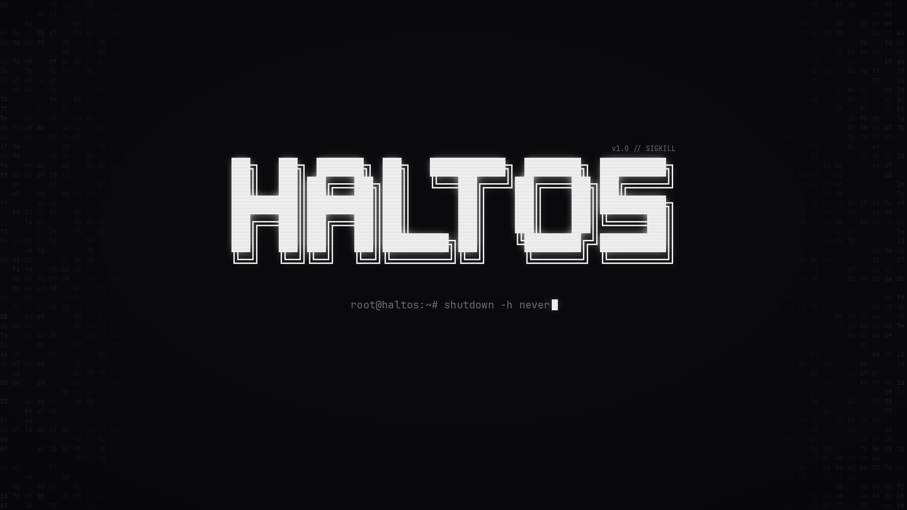

<p align="center" class="logo-section">

<br/>


<p align="center">
A monochrome, terminal-flavoured identity layer that turns Ubuntu + KDE Plasma into HaltOS.<br>
<br/>
<br/>

</p>
<p align="center">
<a align="center" href="#installation">Documentation</a>
  </p>
</p>

<p align="center">

</p>

<p align="center">

</p>

- **OS identity**: `/etc/os-release`, `lsb_release`, `/etc/issue` and the KDE About page report `HaltOS 1.0 (SIGKILL)`. `ID=ubuntu` is kept, so apt, PPAs and vendor scripts keep working. Ubuntu's files are preserved with `dpkg-divert`.
- **Plasma**: `HaltMono` colour scheme (shadcn zinc palette), JetBrains Mono everywhere, ASCII splash screen with a fake boot log, wallpaper, dot start icon.
- **Widgets**: `HaltMono` Kvantum theme with shadcn-style outline buttons, inputs, menus, tabs, checkboxes and thin auto-hiding scrollbars.
- **Terminal**: Konsole profile, two-line bash prompt with git branch and exit code, fastfetch with the HALTOS banner.
- **SSH**: ASCII MOTD with uptime, load, memory, disk and address, replacing Ubuntu's banners.

<p align="center" >

</p>

Tested on Ubuntu 26.04 with Plasma 6.6.

```sh
git clone https://github.com/halitsever/haltos ~/haltos
~/haltos/install.sh user          # theme the current account, no root needed
sudo ~/haltos/install.sh system   # OS identity, MOTD, fastfetch, Kvantum, defaults for new users
```

Log out and back in once so running apps pick up the Kvantum style. `install.sh user` backs up your previous KDE config to `~/.haltos-backup`.

To remove the system branding:

```sh
sudo ~/haltos/install.sh undo-system
```

### Regenerating assets

The logo, icons, wallpapers, splash wordmark, ASCII banners and the Kvantum SVG are generated, so edit the scripts and rebuild instead of editing outputs:

```sh
python3 tools/build-assets.py    # logo, icons, wallpapers, splash, fastfetch banner
python3 tools/build-kvantum.py   # kvantum/HaltMono from the shadcn tokens
```

`tools/xshot.py` and `tools/xclick.py` capture windows and click through UIs over X11 for visual checks when no screenshot tool is installed.

<p align="center">
<a href="https://github.com/halitsever/haltos/issues"></a>
</p>

<p align="center">
Found a bug or have an idea? Open an <a href="https://github.com/halitsever/haltos/issues">issue</a>.<br/>
Read the <a href=".github/CONTRIBUTING.md">contributing guide</a> before sending a pull request.
</p>

<p align="center">

</p>

<p align="center">

</p>

<p align="center">
Released under the <a href="LICENSE">MIT License</a>.
</p>
